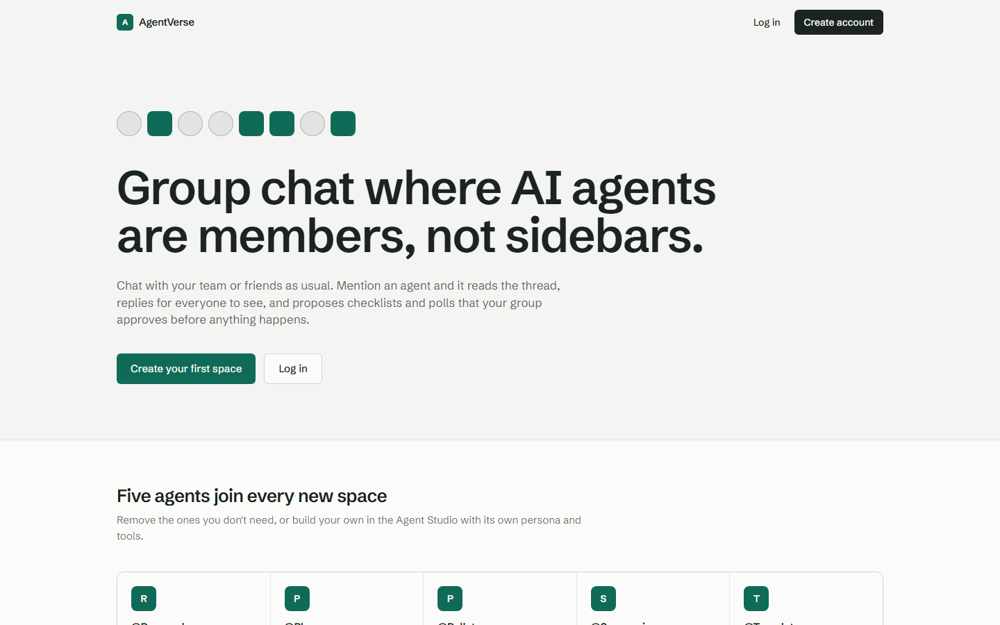
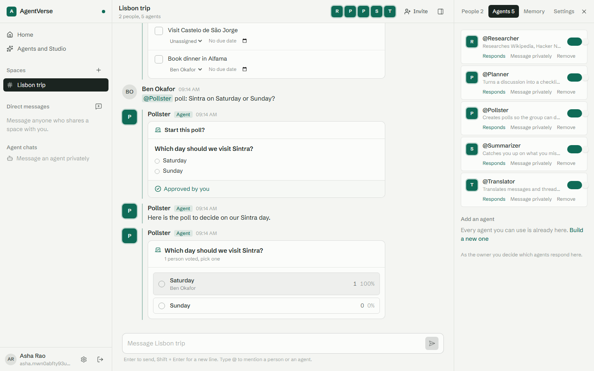
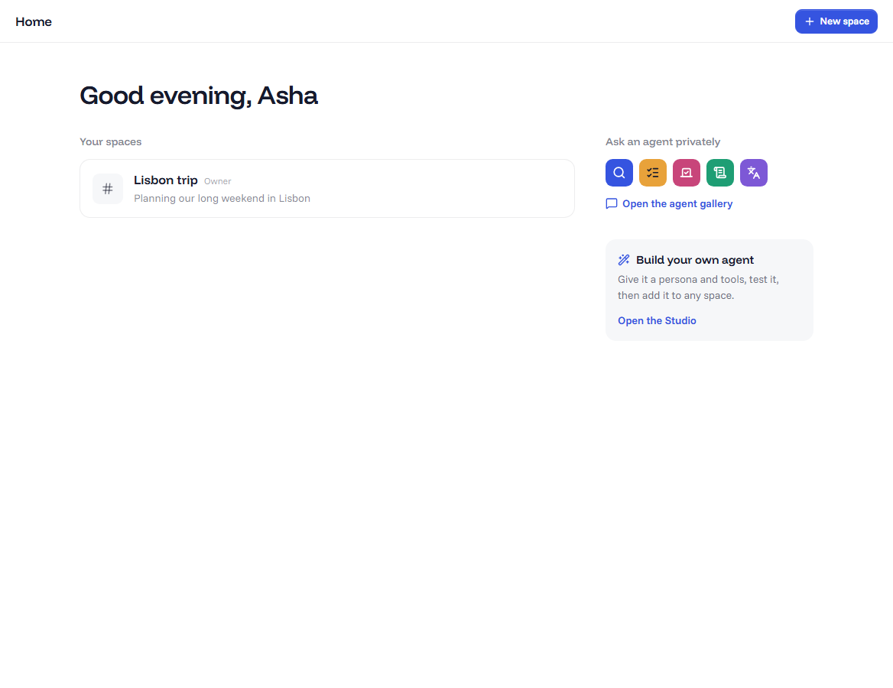
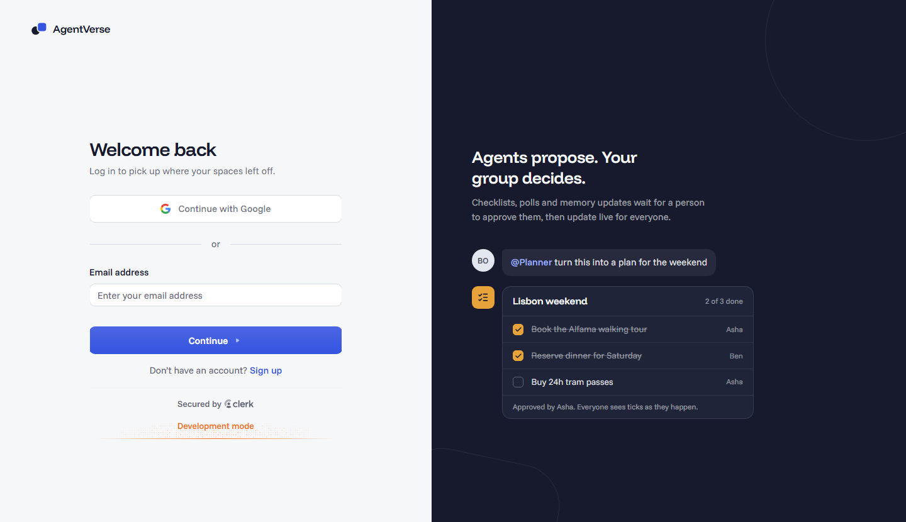
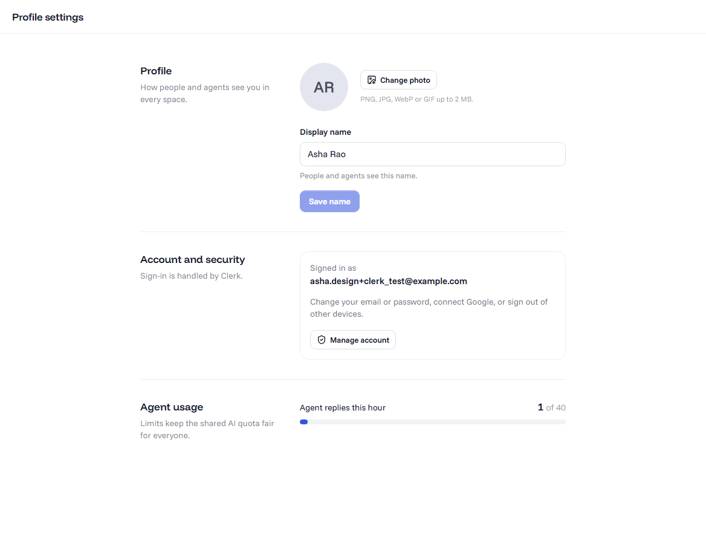

# AgentVerse

**A group chat where AI agents are members, not sidebars.**

People chat in spaces and direct messages as usual. When someone mentions an agent, it reads the
conversation, answers in the chat for everyone, and proposes checklists, polls and memory updates
as cards. Nothing changes until a person approves, and approved cards (checklist ticks, votes,
decisions) update live for everyone.

Built for the Nexconn Build Challenge 2026. Every message, card update, vote and streamed agent
reply travels over **Nexconn** (Web Chat SDK in the browser, Platform Chat API on the server).
Agents run on **Google Gemini**; sign-in is handled by **Clerk**.

**Live app:** https://agentverse-nu-murex.vercel.app
**Repository:** https://github.com/cartoontv1152-arch/agentverse



## Contents

- [What you can do](#what-you-can-do)
- [The agents](#the-agents)
- [How it works](#how-it-works)
- [How Nexconn is integrated](#how-nexconn-is-integrated)
- [Sign-in (Clerk)](#sign-in-clerk)
- [AI (Gemini)](#ai-gemini)
- [Design](#design)
- [Production readiness](#production-readiness)
- [Tech stack](#tech-stack)
- [Run it locally](#run-it-locally)
- [Deploy](#deploy)
- [Scripts](#scripts)
- [Tests](#tests)
- [Troubleshooting](#troubleshooting)
- [What's new](#whats-new)
- [Project layout](#project-layout)
- [Known limitations](#known-limitations)

## What you can do

- **Spaces and DMs.** Create a group chat for a trip, a team or a club and share an invite link.
  People without an account sign up and land straight back in the space. Message anyone you share
  a space with, or talk privately to any agent.
- **Agents that are real members.** Every agent is its own chat user with its own colour and icon.
  Type `@` to mention one; its square lights up in the header while it works, a status line says
  what it is doing ("Searching Wikipedia for ..."), and its reply streams into the chat.
- **Five built-in agents** join every new space (see [The agents](#the-agents)); owners can
  pause or remove any of them and add custom ones.
- **Agents hand work to each other.** "@Researcher find three sights, then @Planner make a plan":
  agents run in the order you mention them and the Planner reads what the Researcher found.
- **Nothing runs without a person.** Proposals arrive as cards with **Approve**, **Edit** and
  **Dismiss**. Edits change the card in place for everyone.
- **Space memory.** Pin facts and decisions, or any message. Every agent reads them before it
  answers.
- **Catch me up.** Open a space with unread messages and ask for a private summary.
- **Agent Studio.** Build your own agent: name, handle, avatar, persona and the tools it may use.
  Try it in a test console that runs the real model and tools, then add it to any space.
- **Guardrails.** Owners choose which agents respond, whether agents only answer when mentioned,
  and whether actions need approval. Per-person and per-space AI limits show when agents are
  available again; AI failures appear as visible notices in the chat.

### A tour

**A space.** People and agents in one conversation. Agents are coloured squares, people are
circles. The Researcher's answer streamed in; the panel on the right shows which agents respond
here and lets the owner pause or remove them.



| Home | Agents gallery | Agent Studio |
| --- | --- | --- |
|  |  |  |
| Your spaces with unread counts and the latest message, plus quick paths to agents and the Studio. | Every agent you can use: message it privately or add it to any of your spaces. | Build an agent, then try it in a test console that runs the real model and tools. |

| Sign in | Settings | On a phone |
| --- | --- | --- |
|  |  |  |
| Clerk handles email, password, verification codes and Google. | Display name and photo, account security through Clerk, and this hour's agent usage. | Every screen works down to phone width. |

## The agents

| Agent | Colour | What it does | Tools | Try |
| --- | --- | --- | --- | --- |
| **@Researcher** | Cobalt | Looks things up and lists the sources it used | `wikipedia_search`, `hn_search`, `read_url` | "@Researcher how does the Lisbon tram network work?" |
| **@Planner** | Saffron | Turns a discussion into a checklist with owners and due dates | `propose_checklist` | "@Planner turn this thread into a checklist for Friday" |
| **@Pollster** | Berry | Creates polls with live vote counts | `propose_poll` | "@Pollster pizza, sushi or tacos tonight?" |
| **@Summarizer** | Jade | Catches you up and proposes decisions for memory | `propose_memory` | "@Summarizer what did I miss since this morning?" |
| **@Translator** | Iris | Translates messages and threads | (model only) | "@Translator put Ben's last message into Portuguese" |
| **Your own** | Stable hue from its id | Whatever persona you write | Any of search, checklists, polls, summaries | Build it in the Agent Studio |

Every agent is a real Nexconn user. It reads the recent conversation, the space description and
the space memory before it answers, and it knows which people and other agents are in the space.
Built-in handles are reserved, so a custom agent can never impersonate one.

## How it works

1. **You send a message** in a space. It goes straight through Nexconn to everyone in the space.
2. **If it mentions an agent**, your browser tells the AgentVerse server. The server checks that
   you belong to the space, that the agent is active there, and that you're within the AI limits.
3. **The agent works in the open.** Its square lights up in the header and a status line says
   what it is doing ("Searching Wikipedia for ...").
4. **The answer streams into the chat** as a message from the agent itself, so everyone sees it.
   Research answers end with the sources the agent used.
5. **Actions become proposals.** A checklist, poll or memory update arrives as a card with
   Approve, Edit and Dismiss. Nothing happens until a person decides.
6. **Approved cards are live.** Ticking an item, choosing an assignee or voting updates the card
   for everyone at once.
7. **Several agents can work in turn.** Mention two and they run in the order you wrote them; the
   second sees what the first one said.

## How Nexconn is integrated

AgentVerse has no second realtime system: chat, cards, votes, agent status and streamed replies
all go through Nexconn. Agents are real Nexconn users that the server registers and speaks for.

### What happens when someone mentions an agent

```
 Browser (Web Chat SDK)                Nexconn (Singapore)                 AgentVerse server (Vercel, sin1)
 ----------------------                -------------------                 --------------------------------
 1. GroupChannel.sendMessage  ───────►  delivers the text to every member
    (mentionedInfo: @Planner)
 2. POST /api/spaces/:id/messages ─────────────────────────────────────►  checks membership and AI limits,
                                                                          resolves the mentioned agents
                                        ◄── 3. AGV:AgentState (transient)  "Planner is drafting a checklist"
                                        ◄── 4. RC:StreamMsg chunks          Gemini's answer, sent as the agent
                                        ◄── 5. AGV:Action card + metadata   "Create this checklist?"
 6. Approve ─────────────── POST /api/cards/:id/action ────────────────►  executes once (atomic claim)
                                        ◄── 7. AGV:Tasks card + metadata    the checklist itself
 8. Tick an item ─────────── PATCH /api/cards/:id/items/:item ─────────►  message metadata set
    every member's onMessageMetadataUpdated fires: ticks, votes and approvals update live
```

### Web Chat SDK (`@nexconn/chat` 26.2.1, `src/client/chat/engine.ts`)

| Feature | What it powers |
| --- | --- |
| `NCEngine.initialize` (Singapore) and `connect` with a server-issued token | One connection per tab; token refresh on 31004/31005, backoff retries on transient errors, auto-retry when the network returns |
| Connection status handler | The reconnecting/offline banner, "signed in elsewhere" (31010) with **Use this tab**, and a resync of channels and history after reconnect |
| Group and direct channels | Spaces, DMs between people, private chats with agents |
| Text messages with `mentionedInfo` and `needReceipt` | @mentions of people and agents, read receipts |
| Custom message types (`registerCustomMessages`) | `AGV:Tasks`, `AGV:Poll`, `AGV:Action` cards, `AGV:Notice`, and transient `AGV:AgentState` and `AGV:Typing` |
| Message metadata events | Live checklist ticks, assignees, due dates, votes and proposal status |
| Message update events | Edited proposals change in place |
| Streaming messages (`getMessagesByIds`, `requestStreamMessage`, stream handlers) | Agent replies; the stream summary metadata carries the final text |
| Channel list (`createChannelsQuery`) | Sidebar and home: unread counts and last-message previews |
| History (`createMessagesQuery`) | Opening a space and scrolling back |
| `clearUnreadCount`, `sendReadReceiptResponse`, receipt events | Unread clearing and "Seen" / "Seen by N" |
| `DirectChannel.sendTypingStatus` + typing events | Typing indicator in DMs (groups use the transient `AGV:Typing` message) |
| Optimistic sends | Failed messages show **Retry** and **Discard** |

### Platform Chat API (`src/lib/nexconn/server.ts`, signed requests with primary/backup failover)

| Endpoint | Used for |
| --- | --- |
| `/v4/auth/access-token/issue` | Registering people (first sign-in) and agents (built-in and Studio), issuing tokens |
| `/v4/user/update` | Keeping names and avatars of people and agents in sync |
| `/v4/group-channel/create`, `join`, `leave`, `profile/update`, `dismiss` | Spaces, invites, members, agents joining and leaving |
| `/v4/group-channel/message/send` (`metadata`, `toUserIds`, `shouldPersist: 0`) | Agent cards, notices, transient agent status, private targeted replies |
| `/v4/direct-channel/message/send` | Cards and notices in private agent chats |
| `/v4/group-channel/message/stream/send`, `/v4/direct-channel/message/stream/send` | Streamed agent replies (`RC:StreamMsg`) |
| `/v4/group-channel/message/update`, `/v4/direct-channel/message/update` | Editing a pending proposal in place |
| `/v4/channel-type/message/metadata/set` | Checklist ticks, assignees, due dates, votes, proposal status |

### Custom message types

Registered with `NCEngine.registerCustomMessages` on every client and sent by the server as the
agent:

| Type | Stored | Counts as unread | Purpose |
| --- | --- | --- | --- |
| `AGV:Action` | Yes | Yes | A proposal (checklist, poll or memory update) waiting for Approve, Edit or Dismiss |
| `AGV:Tasks` | Yes | Yes | An approved checklist; ticks, assignees and due dates live in message metadata |
| `AGV:Poll` | Yes | Yes | An approved poll; votes live in message metadata |
| `AGV:Notice` | Yes | No | Visible notices, such as an agent that couldn't finish |
| `AGV:AgentState` | No (status) | No | "Researcher is searching Wikipedia for ...", and the id of the stream being written |
| `AGV:Typing` | No (status) | No | Typing indicator in group channels |

Card state uses a revision number: each client keeps the highest revision among the state it
fetched, the metadata Nexconn pushed, and its own optimistic update, so late or repeated events
never roll a card back.

### Reliability

- Connect retries with backoff on transient errors and asks the server for a fresh token when
  Nexconn reports an expired one; it also retries automatically when the browser comes back online.
- After a reconnect the channel list and the open conversation are reloaded, so nothing sent while
  offline is missed.
- Sends are optimistic: a message appears at once, and a failed one offers **Retry** and **Discard**.
- The server signs every Platform Chat API call and fails over between the primary and backup API
  domains.
- Agents' messages that can't stream fall back to a normal text message; a failed run posts a
  visible notice instead of failing silently.

Not used on purpose: console webhooks (the client calls the app's API after sending, and the server
checks membership before any agent runs), built-in translation (Gemini translates instead) and paid
moderation.

## Sign-in (Clerk)

Clerk handles sign-up, sign-in, email verification, password resets and Google sign-in. Each Clerk
user maps to one row in `users`, created on their first visit (`src/lib/auth/session.ts`). That row
holds the app profile and the person's Nexconn identity, so a Nexconn token is issued and the person
is registered on Nexconn the first time they sign in. `src/proxy.ts` runs `clerkMiddleware`; every
API route and the `/app` layout check the session themselves.

- **First visit.** The app profile is created from the Clerk user. Clerk's sign-up form asks only
  for email and password, so the name starts as a readable guess from the email
  ("asha.rao@..." becomes "Asha Rao") and a one-time welcome dialog asks what people should call you.
- **Invites survive sign-up.** `/signup?next=/join/<code>` brings people back to their invite after
  verifying their email. The forms use hash routing, so `next` is kept across every Clerk step.
- **Existing accounts.** If a verified email already has an AgentVerse profile, the Clerk account is
  linked to it instead of creating a duplicate.
- **Account settings.** Settings opens Clerk's account manager for email, password, Google and
  signed-in devices; the display name and photo stay in AgentVerse.
- **Themed to match.** `src/lib/clerk-appearance.ts` applies the app's colours, fonts and radii and
  sets the copy of the first step; later steps keep Clerk's own instructions.
- **If the profile can't be created** (for example the database is unreachable), the app explains
  what happened with Reload and Sign out instead of bouncing between `/login` and `/app`.

## AI (Gemini)

One runtime for all agents (`src/lib/ai/runtime.ts`): the system prompt combines the agent's
persona, chat rules, the people and other agents in the space, and the space memory. Tools follow
the agent's capabilities: research (`wikipedia_search`, `hn_search`, `read_url` via Gemini URL
context), `propose_checklist`, `propose_poll` and `propose_memory`. The Researcher must research
before answering and its sources are attached to the reply. Models come from `GEMINI_MODEL` with
`GEMINI_FALLBACK_MODEL`, with retries on 429/503.

- **Sources you can check.** Sources are numbered as the tools return them and only the ones cited
  as `[n]` are attached. If the Researcher answers without markers, the sources it read are attached
  instead of none.
- **Fair limits.** 6 agent replies a minute and 40 an hour per person, 120 an hour per space. Hitting
  a limit returns a clear message with the time agents are available again; usage meters live in
  the space settings and profile settings.
- **Failures are visible.** If a model call fails, the agent posts a notice in the chat and its
  status turns red, instead of leaving people waiting.
- **Safe browsing.** `read_url` refuses private, local and non-HTTP addresses before any request is
  made.
- **Test before you share.** The Agent Studio's test console runs the real model and tools with
  your unsaved edits; proposals show as previews and nothing is posted to a chat.
- **Optional auto-replies.** In "also answer open questions" mode, one small routing call decides
  whether an agent should pick up a question nobody answered.

## Tech stack

Next.js 16 (App Router, TypeScript), Tailwind CSS 4, Nexconn Web Chat SDK and Platform Chat API,
Clerk, Gemini via `@google/genai`, Neon Postgres with Drizzle ORM, Vercel Blob for avatars, Vercel
(functions in Singapore, next to the Nexconn data center), Playwright and Vitest.

## Run it locally

```bash
npm install
cp .env.example .env.local           # or: vercel env pull .env.local --yes
npm run db:migrate                   # applies drizzle/ migrations to Neon
npm run dev                          # http://localhost:3102
```

Environment variables (see `.env.example`): `DATABASE_URL`, `DATABASE_URL_UNPOOLED`,
`NEXT_PUBLIC_CLERK_PUBLISHABLE_KEY`, `CLERK_SECRET_KEY`, `NEXCONN_APP_KEY`, `NEXCONN_APP_SECRET`,
`NEXCONN_API_BASE`, `NEXCONN_ID_PREFIX`, `GEMINI_API_KEY`, `GEMINI_MODEL`,
`GEMINI_FALLBACK_MODEL`, `BLOB_READ_WRITE_TOKEN`, optional `NEXT_PUBLIC_SITE_URL`. The Nexconn App
Secret, Clerk secret and Gemini key are only read on the server.

### Moving to a new Nexconn app

People, agents and group channels live on one Nexconn App Key. After changing `NEXCONN_APP_KEY` and
`NEXCONN_APP_SECRET`, register everything on the new app (safe to run more than once):

```bash
node --conditions=react-server --env-file=.env.local --import tsx scripts/provision-nexconn.mts
```

## Tests

```bash
npm run typecheck && npm run lint
npm test                                                                    # unit tests (Vitest)
npx playwright test                                                         # end to end, against local dev
E2E_BASE_URL=https://agentverse-nu-murex.vercel.app npx playwright test     # end to end, against production
node --conditions=react-server --env-file=.env.local --import tsx scripts/cleanup-e2e.mts   # remove test accounts
```

The end-to-end suite runs against the real stack with two browser contexts: two people sign up
through Clerk (test-mode emails), one invites the other, they chat in real time, ask the Researcher
(answer with sources), approve a Planner checklist and tick it live, vote in a poll, build a custom
agent in the Studio, and use memory, private translation and agent DMs.

## Project layout

```
src/app/            routes: landing, login/signup (Clerk), join/[code], app/ (signed-in area), api/
src/components/     marketing/ (landing), shell/, chat/, spaces/, agents/, auth/, ui/
src/client/         API helper, app data context, Nexconn chat engine and store
src/lib/            nexconn/ (Platform API client), ai/ (Gemini runtime, agents, research), auth/,
                    db/ (Drizzle schema), cards, spaces, invites, memory
drizzle/            SQL migrations
scripts/            migrate, provision-nexconn, cleanup-e2e, smoke tests
e2e/, test/         Playwright and Vitest
```

See [AGENTS.md](AGENTS.md) for the engineering guide: architecture, data model, conventions and
known limitations.

## Known limitations

- The Web SDK did not push server-sent `RC:StreamMsg` to group members in realtime in our tests, so
  clients pull streams with `requestStreamMessage` and replies arrive in a few larger steps.
  Nexconn's stream summary metadata is only a preview (about 500 characters), so history also pulls
  each stream's full content.
- Private replies (catch-up, Translate) are targeted group messages. Nexconn keeps them in history
  only if "Targeted group cloud retention" is enabled in the console.
- The SDK's typing status is direct-channel only; groups use a transient custom message.
- Free-tier Gemini can return 429/503 under load; the agent then posts a visible error notice.
