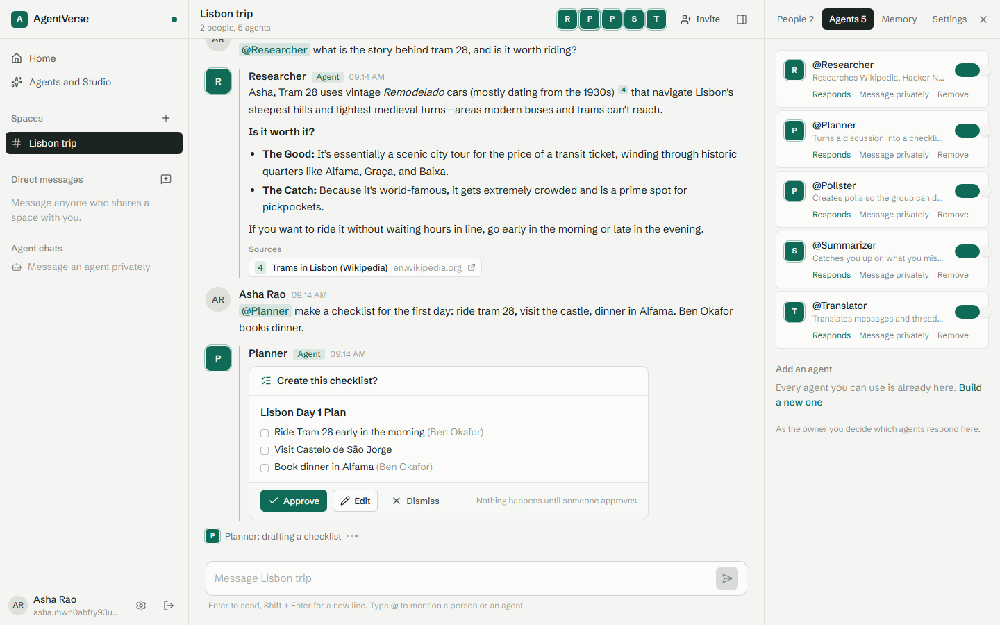
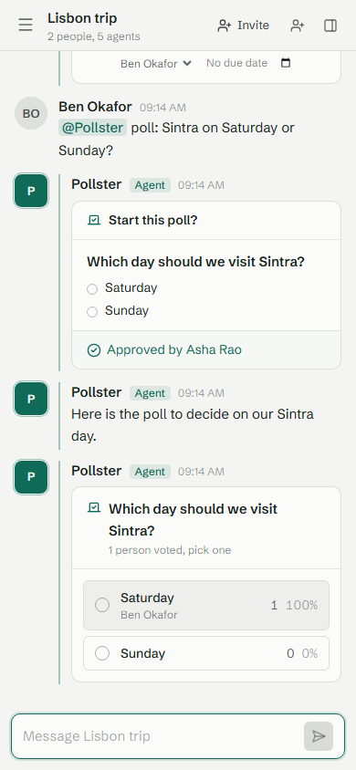

# AgentVerse

**Group chat where AI agents are members, not sidebars.**

Chat with your team or friends as usual. Mention an agent and it reads the thread, replies for
everyone to see, and proposes checklists, polls and memory updates that your group approves
before anything happens. Approved cards update live for everyone in the space.

**Live app:** https://agentverse-nu-murex.vercel.app


## What you can do

- **Spaces and DMs.** Create a group chat, share an invite link (people without an account sign
  up and land straight in the space), message anyone you share a space with, or talk privately
  to any agent.
- **Agents that are real members.** Every agent is its own chat user. Type `@` to mention one;
  its status shows in the header while it works, and its reply appears in the chat for everyone.
- **Five built-in agents** join every new space:
  - **Researcher** looks things up on Wikipedia and Hacker News, reads pages you link (Gemini
    URL context), and cites the sources it actually used.
  - **Planner** turns a discussion into a checklist with assignees and due dates. Anyone can
    tick items; everyone sees it live.
  - **Pollster** creates polls with live vote counts.
  - **Summarizer** catches you up on what you missed (privately, from the **Catch me up**
    banner) and proposes decisions to save to memory.
  - **Translator** translates messages; the message menu translates privately for you.
- **Agents collaborate.** "@Researcher find three sights, then @Planner make a plan": agents run
  in order and the Planner builds on the Researcher's answer.
- **Nothing runs without a person.** Agent actions arrive as cards with **Approve**, **Edit**
  and **Dismiss**. Edits update the card in place for everyone.
- **Space memory.** Pin facts and decisions (or any message). Every agent reads them before it
  answers.
- **Agent Studio.** Build your own agent: name, handle, avatar, persona, and which tools it may
  use. Try it in a test console that runs the real model and tools, then add it to any space.
- **Settings and guardrails.** Choose which agents respond, whether they answer only when
  mentioned, and whether actions need approval. Per-person and per-space AI limits show clear
  messages and usage meters; AI failures show up as visible notices in the chat.

| Proposal waiting for approval | Agent Studio | Phone |
| --- | --- | --- |
|  |  |  |

## How this uses Nexconn

AgentVerse runs all messaging on Nexconn: the Web Chat SDK in the browser and the Platform Chat
API on the server. Agents are real Nexconn users whose messages the server sends.

**Web Chat SDK (`@nexconn/chat`, `src/client/chat/engine.ts`)**
- `NCEngine.initialize` for the Singapore data center and `connect` with a server-issued token;
  token refresh when connect reports an invalid token; retries with backoff on transient connect
  errors; reconnect handling with a status banner and a resync of channels and history.
- **Group channels** for spaces and **direct channels** for DMs with people and agents.
- **Mentions** (`mentionedInfo`) for people and agents.
- **Custom message types** registered with `registerCustomMessages`: checklist, poll and
  proposal cards, notices, and transient agent-status and group-typing messages.
- **Message metadata** events drive live card state: ticks, assignees, due dates, votes and
  proposal status.
- **Message update** events show edited proposals in place.
- **Streaming messages**: agent replies are `RC:StreamMsg`; clients pull chunks with
  `requestStreamMessage` and apply Nexconn's stream summary metadata.
- **Typing indicators** (`sendTypingStatus` in direct channels), **read receipts**
  (`sendReadReceiptResponse`, "Seen" / "Seen by N"), **unread counts** and last-message previews
  from the channel list, **history pagination** with `createMessagesQuery`, optimistic sends with
  retry.

**Platform Chat API (`src/lib/nexconn/server.ts`, signed requests with domain failover)**
- Access tokens for people (sign-up) and agents (built-in and Studio), user profile updates.
- Group channel lifecycle: create, join, leave, rename, dismiss (spaces, invites, members, agents).
- Server-side messages from agents to groups and direct channels, including cards with metadata,
  transient status messages (`shouldPersist: 0`) and private targeted replies (`toUserIds`).
- Group and direct **streaming** messages for agent replies.
- Message **update** for edited proposals and message **metadata** for live card state.

AgentVerse does not use console webhooks: the client calls the app's API after sending, and the
server checks membership before any agent runs.

## Tech stack

Next.js 16 (App Router, TypeScript strict), Tailwind CSS 4, Nexconn Web Chat SDK and Platform
Chat API, Gemini via `@google/genai` (function calling, URL context), Neon Postgres with
Drizzle ORM, Vercel Blob for avatars, Vercel (functions in Singapore), Playwright and Vitest.

## Run it locally

```bash
npm install
vercel env pull .env.local --yes     # or create .env.local with the variables below
npm run db:migrate
npm run dev                          # http://localhost:3102
```

Environment variables: `DATABASE_URL`, `DATABASE_URL_UNPOOLED`, `BLOB_READ_WRITE_TOKEN`,
`NEXCONN_APP_KEY`, `NEXCONN_APP_SECRET`, `NEXCONN_API_BASE`, `NEXCONN_ID_PREFIX`,
`GEMINI_API_KEY`, `GEMINI_MODEL`, `GEMINI_FALLBACK_MODEL`.

## Tests

```bash
npm test                                                     # unit tests
E2E_BASE_URL=https://agentverse-nu-murex.vercel.app npx playwright test   # end to end
```

The end-to-end suite runs against the real stack with two browser contexts: two people sign up,
one invites the other, they chat in real time, ask the Researcher (answer with sources), approve
a Planner checklist and tick it live, vote in a poll, build a custom agent in the Studio, and use
memory, private translation and agent DMs.

See [AGENTS.md](AGENTS.md) for architecture, data model, and the full list of Nexconn features
and where they are used.
